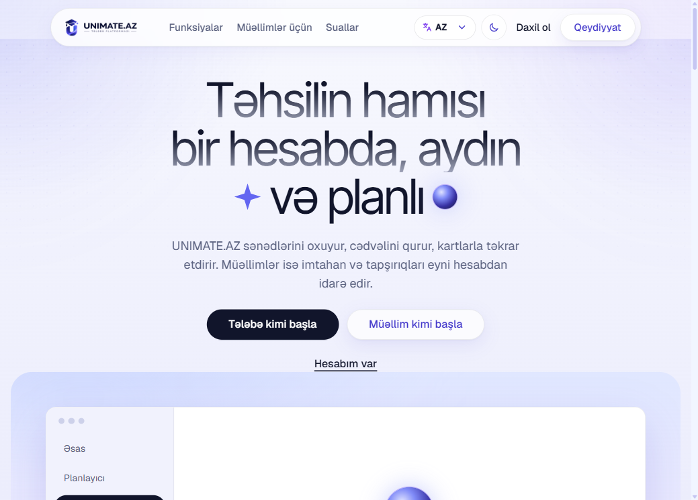
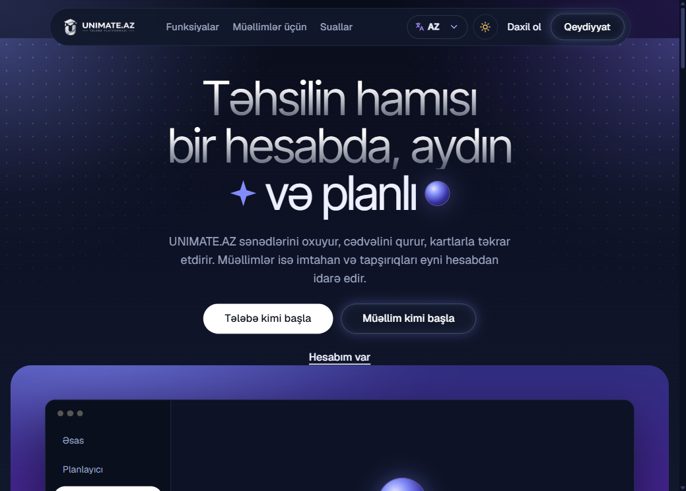
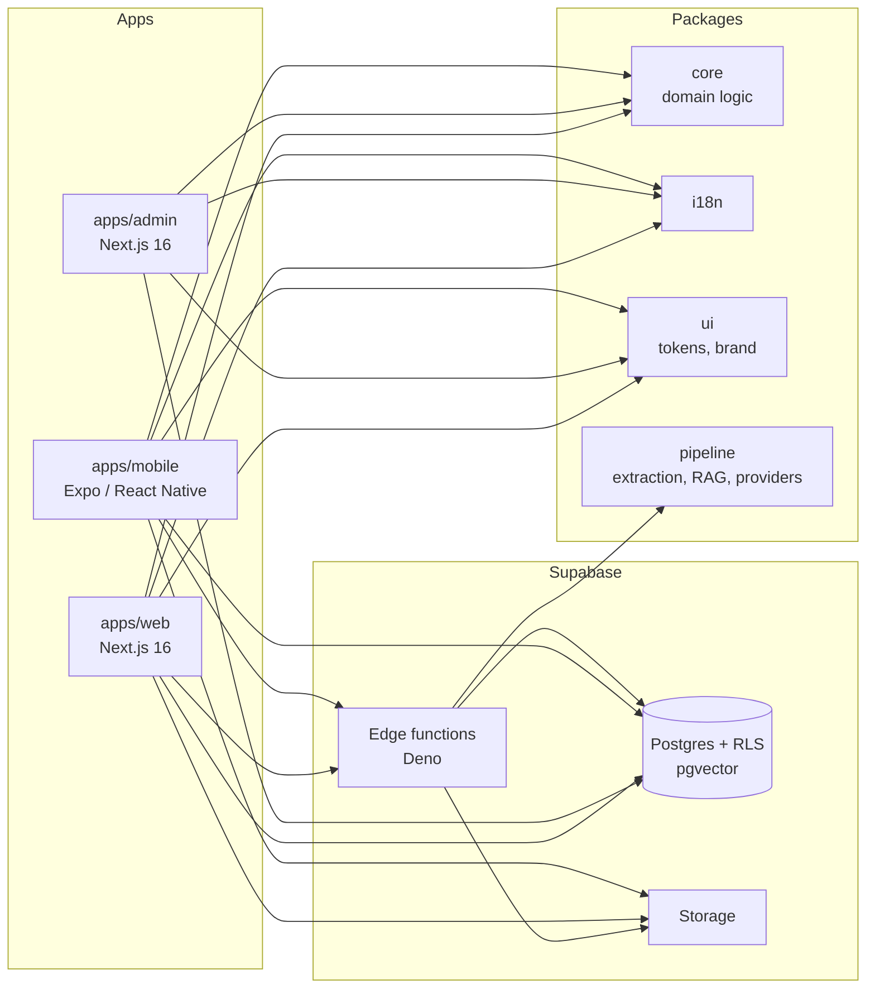

<div align="center">

<picture>
  <source media="(prefers-color-scheme: dark)" srcset="assets/branding/generated/full-logo-white.png">
  
</picture>

**A study platform for students and teachers in Azerbaijan.**

[](https://github.com/ehedagaabbaszade-collab/UNIMATE.AZ/actions/workflows/ci.yml)


</div>

## Overview

UNIMATE.AZ turns a student's own course material into study aids, coursework drafts, a semester plan and a campus community, and gives teachers tools for classes, exams and assignments. One account works across the web app and the mobile app, with separate student and teacher portals and a staff admin console behind the same Supabase backend. Azerbaijani is the default language; Turkish, English and Russian are fully supported.

## Screenshots

| Light | Dark |
| - | - |
|  |  |

## Features

**Students** (web and mobile)
- **AI Study**: upload PDF, DOCX or PPTX files; summaries, quizzes, flashcards, exam simulation and document chat with page citations. Output follows the user's language.
- **Writing studio**: independent coursework and presentations in university format, exported as PDF.
- **Planner and GPA**: schedule, deadlines (including class deadlines), semester plan, GPA calculator, budget, focus timer.
- **Notes** library and shared resources.
- **Campus**: communities, posts, Q&A, events and study groups per institution.
- **Career**: job listings, CV builder with AI feedback, interview preparation.
- **Gamification**: XP and levels, with server-side grading and XP.
- **Colleges** directory and academic catalog.

**Teachers**
- **Classes** with invite codes.
- **Online exams**, including AI-assisted question generation.
- **Question bank**.
- **Assignments** and collection of student submissions, with results.

**Admin console** (staff only): users, moderation, content, academic data, career, jobs, subscriptions and plans, AI routing, prompts and budgets, system config, analytics and an append-only audit log.

## Architecture



| Path | Contents |
| - | - |
| `apps/web` | Student and teacher web app (Next.js, port 3000) |
| `apps/admin` | Staff console (Next.js, port 3001) |
| `apps/mobile` | Expo / React Native app (Expo Router) |
| `packages/core` | Pure domain logic: quotas, GPA, XP, spaced repetition, AI routing math |
| `packages/db` | Database tests on PGlite |
| `packages/pipeline` | Document extraction, RAG, provider adapters |
| `packages/i18n` | Message catalogs and locale utilities |
| `packages/ui` | Design tokens, brand components, icons |
| `supabase/` | Config, migrations, edge functions, seed data, auth email templates |
| `scripts/`, `tools/lint/`, `tests/` | Brand asset build, ESLint toolchain, perf and journey tests |

## Engineering quality

- **Tests**: 163 test files, 1995 tests passing (`npx vitest run`). Database logic runs on PGlite: migrations, RLS, RPCs, quotas, XP, AI budgets and account purge.
- **TypeScript strict** in every workspace; `npm run typecheck` runs them all.
- **ESLint** in its own toolchain (`tools/lint`).
- **CI** ([`ci.yml`](.github/workflows/ci.yml)): `verify` (install, lint, typecheck, Vitest, web and admin production builds) and `mobile-export` (`expo export` for Android), on pull requests and pushes to `main`/`master`.
- **Security**: RLS on application tables, `SECURITY DEFINER` RPCs that re-check roles, server-side quiz grading and XP, audited admin writes, service-role key only in edge function secrets, and scan tests that guard `NEXT_PUBLIC_*` / `EXPO_PUBLIC_*` against secrets. AI providers fail closed when unconfigured, with per-user, per-plan and global spend ceilings.
- **i18n**: four locales (az, tr, en, ru) across web, admin, mobile, emails, notifications and AI output; all UI strings come from translation keys. See [docs/I18N.md](docs/I18N.md).
- **Theming**: light and dark themes with an official brand pack ([docs/BRAND_IDENTITY.md](docs/BRAND_IDENTITY.md)).

## Built with Claude Code

The project is developed with Claude Code. A project-level `CLAUDE.md` sets the conventions: the four-language rule, no secrets in public env vars, fakes only in tests, and honest per-module status reporting. Work is routed to subagents defined in `.claude/agents` and the user-level configuration: a searcher for lookups, an implementer for scoped edits, a test runner, and a reviewer reserved for risky changes (RLS and migrations, auth, quotas, file parsing). The agents follow a short-report rule and verify changes with the test suite.

## Getting started

Requires Node.js 24 (as used in CI).

```bash
npm install
npm test
```

Supabase local stack, environment variables and running the apps: [docs/LOCAL_SETUP.md](docs/LOCAL_SETUP.md).

| Command | Does |
| - | - |
| `npm test` | `vitest run` |
| `npm run typecheck` | `tsc --noEmit` in every workspace |
| `npm run lint` | Installs `tools/lint`, runs ESLint |
| `npm run build` | Builds web and admin |
| `npm run perf` | PGlite hot-path perf smoke ([docs/PERFORMANCE.md](docs/PERFORMANCE.md)) |
| `npm run brand:build` | Regenerates brand assets |
| `npm run dev -w @unimate/web` / `-w @unimate/admin` | Dev servers |
| `npm run start -w @unimate/mobile` | Expo dev server |

## Documentation

- Setup and release: [LOCAL_SETUP](docs/LOCAL_SETUP.md), [DEPLOYMENT](docs/DEPLOYMENT.md), [MOBILE_BUILD](docs/MOBILE_BUILD.md), [RELEASE_CHECKLIST](docs/RELEASE_CHECKLIST.md), [STORE_LISTING](docs/STORE_LISTING.md), [BETA_GUIDE](docs/BETA_GUIDE.md)
- Backend and AI: [AI_PROVIDERS](docs/AI_PROVIDERS.md), [AI_COST_OPTIMIZATION](docs/AI_COST_OPTIMIZATION.md), [POSTGRES15](docs/POSTGRES15.md), [ACCOUNT_DELETION](docs/ACCOUNT_DELETION.md), [ADMIN](docs/ADMIN.md), [PERFORMANCE](docs/PERFORMANCE.md), [DEPENDENCY_AUDIT](docs/DEPENDENCY_AUDIT.md)
- Product: [PRODUCT](PRODUCT.md), [I18N](docs/I18N.md), [BRAND_IDENTITY](docs/BRAND_IDENTITY.md), [ROLIO_INTEGRATION](docs/ROLIO_INTEGRATION.md) (in Azerbaijani)
- Status: [FINAL_DELIVERY_REPORT](docs/FINAL_DELIVERY_REPORT.md), [PROGRESS](PROGRESS.md)

## Status and roadmap

**Verified locally:** unit and database tests (PGlite, PostgreSQL 18), type checks, lint, web and admin production builds, and an Android `expo export`.

**Not yet verified against live services:** a hosted Supabase project (Auth, Storage, scheduled jobs, PostgreSQL 15 behaviour), Deno edge functions, a real AI provider (no provider or model is configured; AI calls fail closed), real devices and browsers, and a screen-reader pass.

**Awaiting credentials and approvals:** Supabase project, AI provider key, store and EAS accounts, domain and legal review, native-speaker review of az/tr/ru copy.

**Known gaps** (full list in the delivery report): push notification delivery, payments (plans are display-only; admin grants only), staff MFA, scheduler configuration for purge and reminders, end-to-end browser tests.

**Planned:** Career integration with Rolio. It is research only; no code exists and it depends on partner API access.

## License

Copyright © 2026 Ehedaga Abbaszade. All rights reserved.

This is proprietary software. The source is visible for review only: no part of it may be used, copied, modified, distributed or hosted without prior written permission. See [LICENSE](LICENSE).
